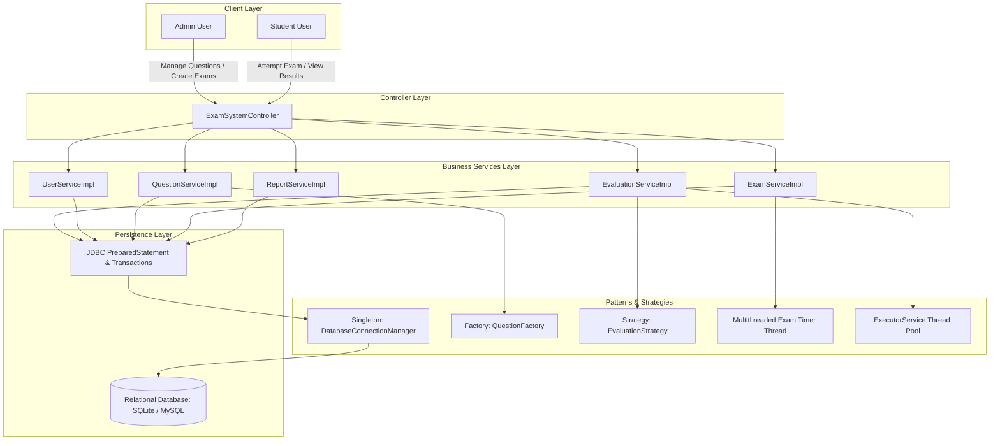

# Online Examination & Result Processing System (Capstone Project)

A backend-only Java enterprise system that manages online examinations, evaluates answers concurrently, and generates analytics and transcripts using **Core Java (OOP)**, **Java 8+ Features (Streams, Lambdas, Optional)**, **Multithreading & Concurrency**, **JDBC Database Persistence**, and **GoF Design Patterns**.

---

## 1. System Architecture & Workflow



---

## 2. Technical Feature Implementation

### A. Core Java & Object-Oriented Design (OOP)
- **Service Interfaces & Implementations**: Clean separation with interfaces (`UserService`, `QuestionService`, `ExamService`, `EvaluationService`, `ReportService`).
- **Abstract Question Hierarchy**: `Question` abstract base class extended by `McqQuestion`, `TrueFalseQuestion`, and `NumericalQuestion` with polymorphic answer evaluation.
- **Encapsulation**: Strict private fields with immutable collections returned via `Collections.unmodifiableList()`.

### B. Java Collections Framework
- **Caching**: `ConcurrentHashMap<Integer, Question>` for high-throughput question bank lookups without database roundtrips.
- **Aggregation**: `List`, `Map<Integer, String>`, and `Set` collections used across student submissions, exam schedules, and candidate rankings.

### C. Java 8+ Functional Programming
- **Streams API**:
  - Filtering questions by subject and difficulty: `filter(q -> q.getSubject().equalsIgnoreCase(subject) && q.getDifficulty() == difficulty)`.
  - Result score calculation and summary statistics: `results.stream().mapToDouble(ExamResult::getScore).summaryStatistics()`.
  - Leaderboard ranking: `results.stream().sorted(Comparator.comparingDouble(ExamResult::getScore).reversed()).limit(limit)`.
- **Lambda Expressions & Method References**: Used throughout stream pipelines (`ExamResult::getScore`, `Question::getPoints`).
- **`Optional` Class**: Prevents `NullPointerException` across database lookups (`Optional<User>`, `Optional<Question>`, `Optional<Exam>`).

### D. Multithreading & Concurrency
- **Exam Timer Thread**: Dedicated countdown daemon thread per student attempt. Cancels if submitted on time; automatically fires `autoSubmit` if time expires.
- **Parallel Submission Evaluation**: Multi-worker `ExecutorService` (fixed thread pool) evaluates student submissions concurrently.

### E. JDBC & Relational Database Integration
- **Secure Credentials**: Reads credentials from environment variables (`DB_URL`, `DB_USER`, `DB_PASSWORD`), defaulting safely to SQLite.
- **SQL Injection Prevention**: 100% parameterized queries using `PreparedStatement`.
- **Transactions & Batch Processing**: Atomic evaluation result storage using `conn.setAutoCommit(false)`, `ps.addBatch()`, `ps.executeBatch()`, `conn.commit()`, and `conn.rollback()` on error.

### F. Exception Handling & Custom Exceptions
- `AuthenticationException`: Invalid credentials or unauthorized role access.
- `InvalidExamException`: Invalid exam configuration or empty question assignment.
- `TimeExpiredException`: Triggered when exam time expires.

### G. Software Design Patterns
1. **Singleton Pattern**: `DatabaseConnectionManager` with thread-safe double-checked locking.
2. **Factory Pattern**: `QuestionFactory` instantiates polymorphic question types (`MCQ`, `TRUE_FALSE`, `NUMERICAL`).
3. **Strategy Pattern**: Pluggable evaluation algorithms (`StandardEvaluationStrategy` vs. `PenaltyEvaluationStrategy` negative marking).
4. **Backend MVC**: Decoupled Model, Service, and Controller layers.

---

## 3. Database Schema (`schema.sql`)

```sql
CREATE TABLE IF NOT EXISTS users (
    id INTEGER PRIMARY KEY AUTOINCREMENT,
    username VARCHAR(50) UNIQUE NOT NULL,
    password_hash VARCHAR(255) NOT NULL,
    full_name VARCHAR(100) NOT NULL,
    email VARCHAR(100) UNIQUE NOT NULL,
    role VARCHAR(20) NOT NULL
);

CREATE TABLE IF NOT EXISTS questions (
    id INTEGER PRIMARY KEY AUTOINCREMENT,
    text TEXT NOT NULL,
    subject VARCHAR(50) NOT NULL,
    difficulty VARCHAR(20) NOT NULL,
    question_type VARCHAR(20) NOT NULL,
    options TEXT,
    correct_answer VARCHAR(255) NOT NULL,
    points REAL NOT NULL DEFAULT 1.0
);

CREATE TABLE IF NOT EXISTS exams (
    id INTEGER PRIMARY KEY AUTOINCREMENT,
    title VARCHAR(100) NOT NULL,
    subject VARCHAR(50) NOT NULL,
    duration_minutes INTEGER NOT NULL,
    scheduled_time TEXT NOT NULL,
    total_marks REAL NOT NULL,
    passing_percentage REAL NOT NULL DEFAULT 40.0
);

CREATE TABLE IF NOT EXISTS exam_questions (
    exam_id INTEGER NOT NULL,
    question_id INTEGER NOT NULL,
    PRIMARY KEY (exam_id, question_id)
);

CREATE TABLE IF NOT EXISTS exam_results (
    id INTEGER PRIMARY KEY AUTOINCREMENT,
    exam_id INTEGER NOT NULL,
    student_id INTEGER NOT NULL,
    score REAL NOT NULL,
    max_score REAL NOT NULL,
    percentage REAL NOT NULL,
    grade VARCHAR(5) NOT NULL,
    status VARCHAR(20) NOT NULL,
    evaluated_at TEXT NOT NULL
);
```

---

## 4. End-to-End Program Output (`OnlineExamSystemApp`)

```text
==========================================================================
   ONLINE EXAMINATION & RESULT PROCESSING SYSTEM (CAPSTONE BACKEND)       
==========================================================================

--------------------------------------------------------------------------
  SECTION 1: USER MANAGEMENT & AUTHENTICATION
--------------------------------------------------------------------------
Registered Users in Database:
  [Admin]   User[ID=1, User='admin_vinay', Name='Vinay Madarkhandi', Role=ADMIN]
  [Student] User[ID=2, User='student_alice', Name='Alice Johnson', Role=STUDENT]
  [Student] User[ID=3, User='student_bob', Name='Bob Smith', Role=STUDENT]
  [Student] User[ID=4, User='student_charlie', Name='Charlie Brown', Role=STUDENT]
  [Student] User[ID=5, User='student_diana', Name='Diana Prince', Role=STUDENT]

Testing Login Validation:
  Authentication Successful for: Vinay Madarkhandi (Role: ADMIN)

Testing Role-Based Access Control (Student attempting admin task):
  Security Intercepted Expected Exception: Access Denied: Administrative privileges required.

--------------------------------------------------------------------------
  SECTION 2: QUESTION BANK MANAGEMENT (FACTORY PATTERN)
--------------------------------------------------------------------------
Added 5 questions to database repository with automated caching.

Filtering Questions by Subject 'Java Core' and Difficulty 'MEDIUM':
  [Java Core | MEDIUM | NUMERICAL | 2.0 pts] What is the time complexity of HashSet.contains() in Big-O notation when n=1? (Enter 1)
  [Java Core | MEDIUM | MCQ | 2.0 pts] Which keyword prevents a method from being overridden in a subclass?

--------------------------------------------------------------------------
  SECTION 3: EXAM CREATION & SCHEDULING
--------------------------------------------------------------------------
Exam Created Successfully:
  Title          : Java Enterprise Developer Certification 2026
  Duration       : 60 Minutes
  Schedule       : 2026-11-15 10:00:00
  Passing Target : 60.0%
  Assigned Qs    : 5 Questions

--------------------------------------------------------------------------
  SECTION 4: EXAM ATTEMPTS (MULTITHREADED TIMERS & AUTO-SUBMIT)
--------------------------------------------------------------------------
Starting simulated concurrent student exam sessions...
  [Submission] Alice Johnson  : Status = SUBMITTED_ON_TIME
  [Submission] Bob Smith      : Status = SUBMITTED_ON_TIME
  [Submission] Charlie Brown  : Status = AUTO_SUBMITTED (Time Expired)
  [Submission] Diana Prince   : Status = SUBMITTED_ON_TIME

--------------------------------------------------------------------------
  SECTION 5: PARALLEL EVALUATION (EXECUTOR SERVICE & JDBC BATCH)
--------------------------------------------------------------------------
Active Evaluation Strategy: Negative Marking (-25% Penalty)

Evaluated & Persisted Results via JDBC Batch Transaction:
  Candidate: Alice Johnson      | Score: 10.0/10.0 | Percentage: 100.0% | Grade: A+ | Status: PASSED
  Candidate: Bob Smith          | Score:  7.5/10.0 | Percentage:  75.0% | Grade: B  | Status: PASSED
  Candidate: Charlie Brown      | Score:  1.8/10.0 | Percentage:  17.5% | Grade: F  | Status: FAILED
  Candidate: Diana Prince       | Score:  6.3/10.0 | Percentage:  62.5% | Grade: C  | Status: PASSED

--------------------------------------------------------------------------
  SECTION 6: EXAM ANALYTICS & LEADERBOARD REPORTS
--------------------------------------------------------------------------
--- Exam Performance Analytics Report ---
  Exam Title               : Java Enterprise Developer Certification 2026
  Total Candidates Tested  : 4
  Candidates Passed        : 3
  Candidates Failed        : 1
  Overall Pass Rate        : 75.0%
  Cohort Average Score     : 6.38 marks
  Cohort Highest Score     : 10.0 marks
  Cohort Lowest Score      : 1.8 marks

--- Top Performers Leaderboard ---
  Rank #1: Alice Johnson      | Score: 10.0/10.0 (100.0%) | Grade: A+
  Rank #2: Bob Smith          | Score:  7.5/10.0 (75.0%) | Grade: B
  Rank #3: Diana Prince       | Score:  6.3/10.0 (62.5%) | Grade: C

--- Individual Student Transcript (Alice Johnson) ---
  Exam: Java Enterprise Developer Certification 2026 | Score: 10.0/10.0 | Status: PASSED | Evaluated: 2026-10-31 16:05:12

==========================================================================
Online Examination & Result Processing System demonstration complete!
==========================================================================
```

---

## 5. JUnit 5 Test Run Summary (`mvn clean test`)

```text
[INFO] -------------------------------------------------------
[INFO]  T E S T S
[INFO] -------------------------------------------------------
[INFO] Running com.exam.system.OnlineExamSystemTest
[INFO] Tests run: 7, Failures: 0, Errors: 0, Skipped: 0, Time elapsed: 0.565 s -- in com.exam.system.OnlineExamSystemTest
[INFO] 
[INFO] Results:
[INFO] 
[INFO] Tests run: 7, Failures: 0, Errors: 0, Skipped: 0
[INFO] 
[INFO] ------------------------------------------------------------------------
[INFO] BUILD SUCCESS
[INFO] ------------------------------------------------------------------------
```
